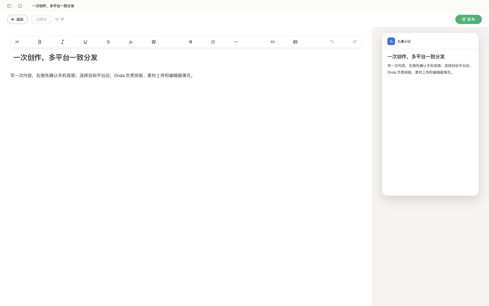
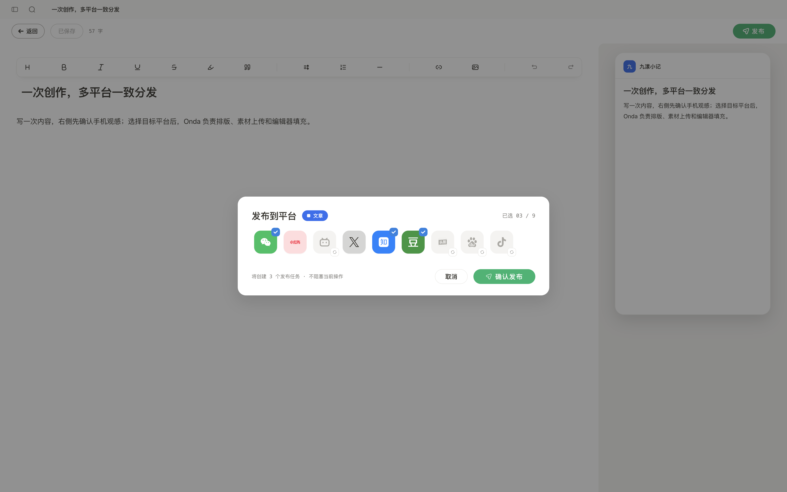
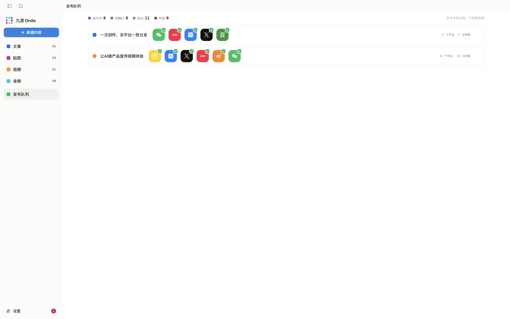
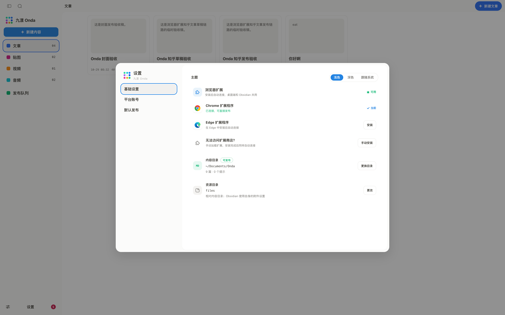
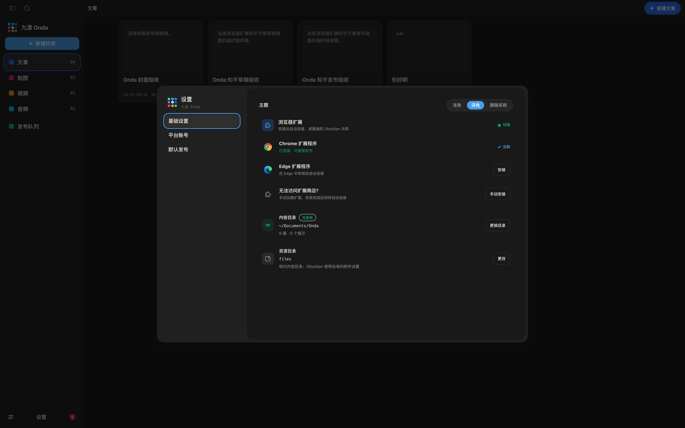
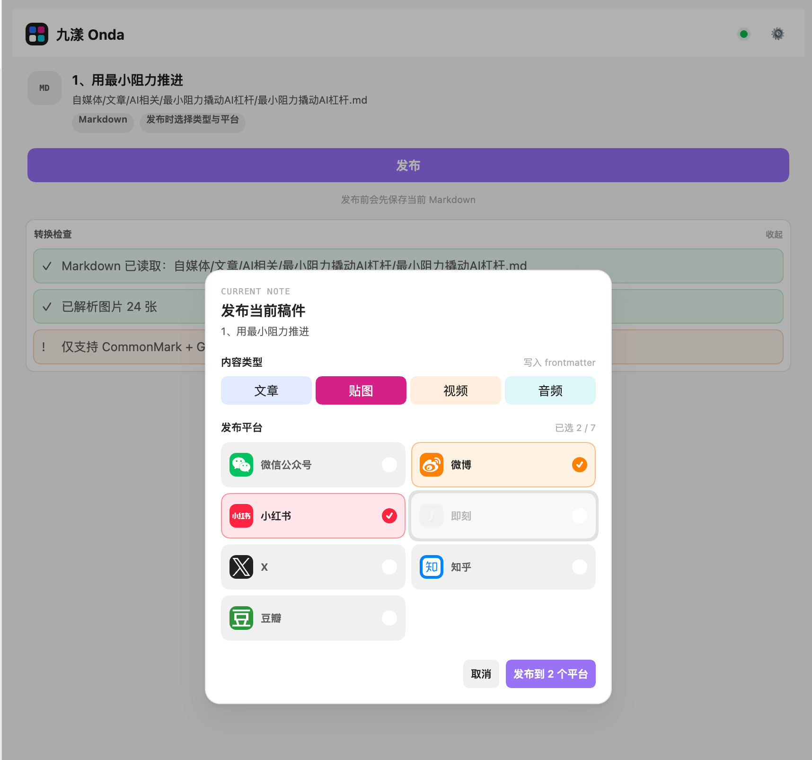
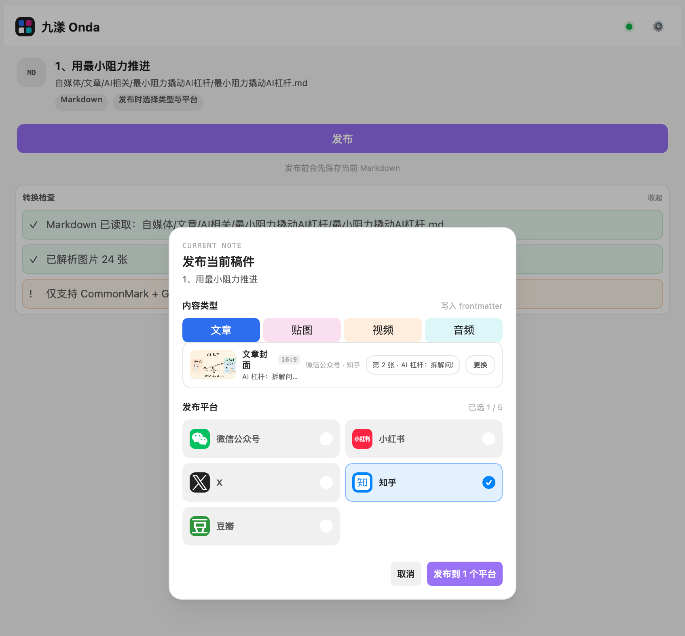

<p align="center">
  
</p>

<h1 align="center">九漾 Onda</h1>

<p align="center">面向中文创作者的多平台内容发布工作台。</p>

## 项目定位

九漾 Onda 把文章、贴图、视频和音频从一份内容准备到多个平台发布的过程集中到一个本机工作台。内容、平台账号和发布任务都在本地处理，不依赖云端内容服务。

产品包含：

- Next.js Web 工作台
- Electron 桌面宿主
- 本机 CLI
- Obsidian 发布插件
- Chrome / Edge 浏览器发布扩展
- Bun + ElysiaJS 本机后端

## 界面预览

### 编辑器 — 实时手机预览



### 多平台发布设置



### 发布队列 — 集中管理发布状态



### 浅色 / 深色主题

<table>
  <tr>
    <th>浅色模式</th>
    <th>深色模式</th>
  </tr>
  <tr>
    <td></td>
    <td></td>
  </tr>
</table>

### Obsidian 发布

| 贴图发布 | 文章发布 |
|---|---|
|  |  |

插件直接读取当前 Markdown，在侧栏选择内容类型与平台，再把发布任务交给同一个本机后端。

### 浏览器扩展

<p align="center">
  
</p>

Chrome 与 Edge 共用一个 MV3 扩展。扩展通过 Native Messaging 自动发现本机 Onda 并连接，不需要复制 Chrome profile，也不需要输入地址或配对码。

## 当前状态

Markdown 直编、独立本机后端和浏览器扩展发布链路已经落地；平台页面驱动与真机验收仍在持续补齐：

| 能力 | 状态 |
|---|---|
| 内容事实源 | Vault Markdown + `tassello` frontmatter |
| 运营状态 | `TASSELLO_DATA_DIR/state/` 文件状态库 |
| 后端 | 独立 Bun + ElysiaJS，HTTP / WebSocket / 文件读写 |
| Web | Next.js 只负责 UI，经 rewrite 访问本机 API |
| Obsidian | 直接编辑 Markdown，发布和任务经本机 API |
| 桌面 | Electron 同时托管 API 与 Web |
| CLI | 按需启动，通过本机 API 查询平台能力、发布 Markdown、跟踪任务并使用豆包生图 |
| 浏览器扩展 | Chrome / Edge MV3 扩展、Native Messaging 自动连接、账号检测、发布任务和 popup 已完成；平台真机验收持续进行 |

目标架构和迁移边界见 [`docs/design/architecture.md`](docs/design/architecture.md)。

## 开发

```bash
bun install
bun run dev
```

常用验证：

```bash
bun run typecheck
bun test packages/vault/src packages/render/src packages/server/src apps/api/src
cd apps/web && bun run lint && bun run build
cd apps/obsidian && bun test src && bun run build && bun run deploy
cd apps/extension && bun run build
```

完整流程见 [`docs/workflow/development-workflow.md`](docs/workflow/development-workflow.md)。

## CLI

`onda` 是九漾 Onda 的按需 CLI，不启动第二个后台服务。它通过本机 API 调用创作与发布任务，实际页面操作仍由已连接的 Onda 浏览器扩展完成。使用前需要：

1. 启动九漾 Onda。
2. 启动 Chrome 或 Edge，并确认 Onda 扩展已连接。
3. 在浏览器中登录目标平台。

桌面安装包会把 CLI 放在：

```text
macOS:   /Applications/Tassello.app/Contents/Resources/bin/onda
Windows: <安装目录>\resources\bin\onda.exe
```

仓库开发时可以直接运行：

```bash
bun run cli -- platforms list --json
```

也可以先构建独立可执行文件：

```bash
bun run build:cli
./apps/cli/dist/onda platforms list --json
```

### 平台与发布

查看当前运行实例的平台、账号状态和内容类型能力：

```bash
onda platforms list --json
onda platforms show wechat --json
```

`platforms list` 同时展示 active 与 planned 平台；`publish` 只接受 active 且账号已连接的平台。

发布 Markdown：

```bash
onda publish wechat article ./note.md --json
onda publish zhihu article ./note.md --wait --timeout 20m --json
onda publish baijiahao image ./note.md --json
onda publish xiaoyuzhou audio ./episode.md --channel <节目ID> --json
```

稿件至少需要有效的 frontmatter：

```md
---
tassello:
  id: m5xk2q9f
  type: article
---

# 标题

正文
```

语法固定为：

```text
onda publish <platform> <type> <file>
```

- `platform` 使用稳定平台 ID，例如 `wechat`、`xhs`、`zhihu`、`baijiahao`。
- `type` 为 `article`、`image`、`video` 或 `audio`。
- `file` 必须是带有效 `tassello.id` 与 `tassello.type` frontmatter 的 Markdown。
- `--vault` 可指定 Markdown 所在根目录；不使用该参数时，相对路径按当前目录解析。
- 播客账号有多个节目、专辑或播单时必须传 `--channel`。
- 发布仍遵循应用的默认人工确认策略；`--wait` 会停在 `awaiting_confirm` 并返回平台页面或草稿链接。

### 创作能力：豆包生图

请求文件示例：

```json
{
  "platform": "doubao",
  "model": "Seedream 5.0 Flash",
  "name": "autumn-window",
  "idempotencyKey": "article-cover-20261029",
  "items": [
    {
      "prompt": "温暖的生活方式插画，16:9 横版构图，一只戴着深绿色围巾的橘猫坐在木质窗台上，柔和纸张纹理，画面中不要出现文字",
      "slug": "orange-cat"
    }
  ]
}
```

创建后立即返回任务 ID：

```bash
onda generate image ./request.json --json
```

创建并等待任务完成：

```bash
onda generate image ./request.json --wait --timeout 20m --json
```

请求也可以从 stdin 传入：

```bash
onda generate image - --json < request.json
```

默认模型为 `Seedream 5.0 Flash`。画面比例直接写入提示词，不提供单独的 `ratio` 参数。同一任务中的提示词会按顺序在同一个豆包对话里执行。

### 发布任务

```bash
onda tasks list --json
onda tasks list --platform zhihu --type article --status awaiting_confirm --json
onda tasks status <task-id> --json
onda tasks wait <task-id> --timeout 20m --interval 2s --json
onda tasks cancel <task-id> --json
onda tasks retry <task-id> --wait --json
onda tasks confirm <task-id> --url "https://example.com/post/1" --json
onda tasks confirm <task-id> --no-public-url --json
```

`tasks confirm` 只用于记录用户在平台已经完成的发布结果，不会再次调用平台发送。

### 生图任务

```bash
onda generate image status <task-id> --json
onda generate image wait <task-id> --timeout 20m --interval 2s --json
onda generate image list --json
onda generate image cancel <task-id> --json
```

`wait` 超时不会取消任务，只返回最后一次任务状态并退出。中断 CLI 也不会取消后台任务；需要停止时显式执行 `cancel`。

成功任务的 `outputs` 包含绝对路径、相对 Vault 路径、分辨率和 SHA-256。默认输出到 Vault 配置的资源目录下：

```text
generated/YYYY-MM-DD-<name>/
```

### 服务发现与 JSON

CLI 按以下顺序查找本机 API：

1. `--api http://127.0.0.1:<port>`
2. `TASSELLO_API_ORIGIN`
3. `TASSELLO_RUNTIME_FILE` 或 `~/.onda/runtime.json`
4. `http://127.0.0.1:4311`

`--json` 输出稳定信封：

```json
{
  "ok": true,
  "data": {
    "id": "t...",
    "platformId": "zhihu",
    "contentType": "article",
    "status": "awaiting_confirm",
    "pageUrl": "https://zhuanlan.zhihu.com/..."
  }
}
```

失败时输出 `ok: false` 和错误码，并使用稳定退出码：

| 退出码 | 含义 |
|---|---|
| `0` | 成功，或任务已创建 |
| `1` | CLI 内部错误 |
| `2` | 参数、请求或 API 拒绝 |
| `3` | 无法连接九漾 Onda |
| `4` | 平台暂未开放或账号未就绪 |
| `5` | 任务已完成页面填写，等待用户在平台确认 |
| `6` | 豆包创作额度耗尽 |
| `7` | 任务明确失败 |
| `8` | 结果未知，不要自动重试 |
| `9` | 任务已取消 |
| `10` | `wait` 超时，任务仍在运行 |

CLI 只接受结构化的创作与发布命令，不读取浏览器 Cookie，不直接连接扩展，也不暴露通用页面自动化能力。

## 文档

- [文档目录与阅读路线](docs/README.md)
- [架构](docs/design/architecture.md)
- [设计语言](docs/design/design-language.md)
- [仓库约定](docs/conventions/repo-conventions.md)
- [开发流程](docs/workflow/development-workflow.md)
- [平台矩阵与验证记录](docs/platforms/README.md)
- [发布通道模型](docs/platforms/publish-channels.md)

## License

MIT
