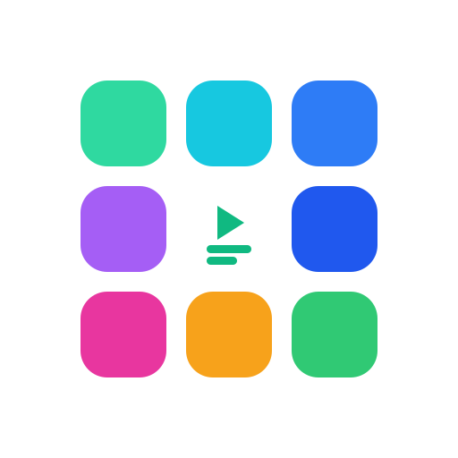

<p align="center">
  
</p>

<h1 align="center">九漾 Onda</h1>

<p align="center">面向中文创作者的多平台内容发布工作台。</p>

## 项目定位

九漾 Onda 把文章、贴图、视频和音频从一份内容准备到多个平台发布的过程集中到一个本机工作台。内容、平台账号和发布任务都在本地处理，不依赖云端内容服务。

产品包含：

- Next.js Web 工作台
- Electron 桌面宿主
- Obsidian 发布插件
- Chrome / Edge 浏览器发布扩展
- Bun + ElysiaJS 本机后端

## 当前状态

Markdown 直编与独立本机后端已经落地；旧平台 CDP 逻辑仍在按扩展驱动逐步迁移：

| 能力 | 状态 |
|---|---|
| 内容事实源 | Vault Markdown + `tassello` frontmatter |
| 运营状态 | `TASSELLO_DATA_DIR/state/` 文件状态库 |
| 后端 | 独立 Bun + ElysiaJS，HTTP / WebSocket / 文件读写 |
| Web | Next.js 只负责 UI，经 rewrite 访问本机 API |
| Obsidian | 直接编辑 Markdown，发布和任务经本机 API |
| 桌面 | Electron 同时托管 API 与 Web |
| 浏览器扩展 | Native Messaging 自动发现/配对、连接、任务协议和 popup 已完成；平台页面驱动仍迁移中 |

目标架构和迁移边界见 [`docs/design/architecture.md`](docs/design/architecture.md)。

## 开发

```bash
bun install
bun run dev
```

常用验证：

```bash
bun run typecheck
bun test packages/vault/src packages/render/src packages/server/src apps/api/src
cd apps/web && bun run lint && bun run build
cd apps/obsidian && bun test src && bun run build && bun run deploy
cd apps/extension && bun run build
```

完整流程见 [`docs/workflow/development-workflow.md`](docs/workflow/development-workflow.md)。

## 文档

- [文档目录与阅读路线](docs/README.md)
- [架构](docs/design/architecture.md)
- [设计语言](docs/design/design-language.md)
- [仓库约定](docs/conventions/repo-conventions.md)
- [开发流程](docs/workflow/development-workflow.md)
- [平台矩阵与验证记录](docs/platforms/README.md)
- [发布通道模型](docs/platforms/publish-channels.md)

## License

MIT
